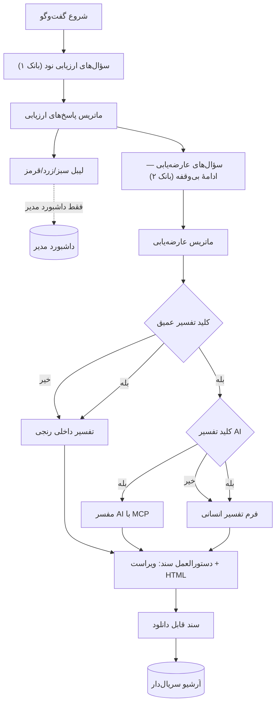

# مشخصات فرایند اصلی «نود ارزیابی» — همان‌طور که از دیاگرام استخراج شد

منبع: `docs/diagrams/main-process.drawio.xml` (دیاگرام مالک محصول) · استخراج ماشینی: `docs/diagrams/main-process.json`
نسخه: ۱ · تاریخ: ۱۴۰۵/۰۷/۲۰ · وضعیت: **پیش‌نویس برای تأیید** (هنوز در کد اعمال نشده)

---

## ۱. جریان (خوانش دقیق دیاگرام)

```
[۱] کاربر دستور شروع گفت‌وگو را می‌دهد
 │
 ├─(کالوت) مکالمه با نام «ارزیابی اولیه» نمایش داده می‌شود؛ هدف: دادن یکی از سه وضعیت.
 │          ⚠ صریح: «این ارزیابی یک فیلتر نیست بلکه یک لیبل است» + «بدون قضاوت کلی»
 │
[۷] سؤال‌های «ارزیابی نود» شروع می‌شود   ←  [۵۹] بانک سؤال «ارزیابی»
 │   نمونهٔ سؤال [۹]: «آیا به نظرتان فلان موضوع چقدر مهم است؟» عددی ۰ تا ۱۰ (نوار/اسلایدر)
 │
[۱۲] همهٔ سؤال‌های ارزیابی پرسیده شد → «ماتریس پاسخ‌ها» آماده می‌شود
 │        └─→ [۵۳] آرشیو در دیتابیس کاربر: «فرم پرشده ... شماره سری می‌گیرد»
 │
[۳۴] فرمول «ماتریس»: تبدیل پاسخ‌ها به رنج ۰..۱۰۰   ←  [۶۱] بانک «فرمول محاسبهٔ ارزیابی»
 │
[۳۸] ماتریس تبدیل‌شده     [۴۰] سناریوهای سه‌گانه     [۴۲] ایجاد لیبل (سبز/زرد/قرمز)
 │        └─→ [۵۳] لیبل در دیتابیس فرد
 │
[۴۵] نمایش لیبل: **فقط در داشبورد مدیر**. «به هیچ وجه در مابقی فرایند دخالت پیدا نمی‌کند و حتی نمایش هم داده نمی‌شود»
 │
[۲۸] «ارزیابی» تمام شد، ولی سؤال‌های «عارضه‌یابی» شروع می‌شود
 │
[۲۵] «بدون اینکه کاربر متوجه شود سؤال‌ها ادامه پیدا می‌کند اما از بانک سؤال عارضه‌یابی است»
 │        └─ (کالوت ۱۰۴) این سؤال‌ها **دو ساید** دارند: پاسخ رنجی + کادر توضیح
 │
[۴۷] سؤال‌های عارضه‌یابی پرسیده می‌شود   ←  [۶۰] بانک سؤال «عارضه‌یابی»
 │   [۶۹] انواع پاسخ: «رنج» + «توضیح اضافه بر رنج»
 │   [۷۷] پس از **هر سؤال** در نشست ذخیره می‌شود؛ رفرش → ادامه؛ شروع از نو → نشست جدید،
 │        ولی دادهٔ نشست قبلی در دیتابیس می‌ماند
 │
[۵۰] سؤال‌های عارضه‌یابی تمام شد → ماتریس آماده می‌شود   ←  [۶۲] بانک «فرمول محاسبهٔ عارضه‌یابی»
 │
[۸۱] ◆ کلید «تفسیر عمیق» در داشبورد مدیر فعال است؟
 │
 ├── «خیر» ─→ [۸۶] تفسیر **فقط رنج** با ماتریس تفسیر عارضه‌یابی، **به‌صورت داخلی (داخل خود سرور)**
 │               ↓
 │             [۹۸] «ماتریس تفسیر عارضه‌یابی رنجی» به‌صورت JSON  →  [۱۰۳] پایان «عارضه‌یابی رنجی»
 │
 └── «بله» ─→ [۷۱] رنج ─→ [۸۶] همان تفسیر داخلی رنجی ─→ [۹۸]
                 و به‌طور همزمان:
                 [۱۰۶] ◆ کلید «تفسیر AI» فعال است؟
                   ├── «بله» ─→ [۱۴] JSON با API به AI ارسال می‌شود
                   │              ↓
                   │            [۱۶] مفسر AI با «دستورالعمل» کار می‌کند
                   │                 (برای مفسر انسانی: «فرم تفسیر» / برای AI: یک **MCP**،
                   │                  چه سرور مجزا چه داخل خود سرور)
                   │              ↓
                   │            [۱۸] «ماتریس تفسیر عمیق عارضه‌یابی (AI)»  →  [۵۳] ذخیرهٔ کددار و سریال‌دار
                   └── «خیر» ─→ [۱۰۸] فقط برای تفسیر انسانی آماده و ارسال می‌شود
                                  ↓
                                [۱۱۱] «ماتریس تفسیر عمیق عارضه‌یابی (فقط انسانی)» → [۵۳] آرشیو + سریال
 │
[۱۰۰] پایان «عارضه‌یابی عمیق»
 │
[۲۰] دستورالعمل **دیگر** برای مرحلهٔ تبدیل به سند: قالب نوشتن (ویراست متن) + قالب نمایش (HTML)
 │
[۲۲] «سند عارضه‌یابی» آماده و برای دانلود قرار می‌گیرد  →  [۵۳] ذخیره
```

## ۲. جدول تصمیم‌های صریح دیاگرام

| موضوع | تصمیم دیاگرام | یادداشت |
|---|---|---|
| ماهیت ارزیابی اولیه | **لیبل، نه فیلتر** | صریح در کالوت شروع |
| نمایش لیبل به کاربر | **هرگز** — فقط داشبورد مدیر | «حتی نمایش هم داده نمی‌شود» |
| اثر لیبل بر بقیهٔ فرایند | **هیچ** | پس سؤال‌های عارضه‌یابی برای همه یکسان‌اند |
| انواع پاسخ | ارزیابی: رنج ۰..۱۰ · عارضه‌یابی: رنج + توضیح | کالوت ۱۰۴ |
| ذخیره‌سازی | پس از هر سؤال، در نشست | ادامه/شروع نو با حفظ دادهٔ قبلی |
| آرشیو | فرم پرشده + ماتریس‌ها + سند: **کددار و سریال‌دار** | چند یال به [۵۳] |
| تفسیر پایه | داخلی و فقط روی **رنج** (پاسخ تشریحی وارد نمی‌شود) | [۸۶] |
| تفسیر عمیق | با کلید مدیر؛ مسیر انسانی همیشه، مسیر AI اختیاری | [۸۱] و [۱۰۶] |
| مفسر AI | با **MCP** (سرور مجزا یا درون سرور) | [۱۶] |
| سند | با **دستورالعمل جداگانه**: ویراست متن + قالب HTML | [۲۰] |

## ۳. حالت‌های ممکن (از دو کلید)

| تفسیر عمیق | تفسیر AI | نتیجه |
|---|---|---|
| خاموش | — | فقط تفسیر داخلی رنجی → سند |
| روشن | خاموش | تفسیر رنجی + **فرم تفسیر انسانی** → سند |
| روشن | روشن | تفسیر رنجی + فرم انسانی + **پیش‌نویس AI** → سند |

## ۴. منابع دادهٔ مرتبط (پیش‌نویس‌های مالک محصول)

```
docs/reference/stage1-screening.owner-draft.yaml   # ۱۵ سؤال / ۸ محور  (منبع لیبل)
docs/reference/stage2-diagnostics.owner-draft.yaml # ۵۴ سؤال / ۹ محور  (عارضه‌یابی)
docs/reference/analyze-owner-drafts.py             # تحلیل عددی این دو سند
```

## ۵. نمودار فشرده (Mermaid)



> **به‌روزرسانی بانک فعال (۲۰۲۶-۱۰-۱۷):** ارزیابی اولیهٔ فعال از شیت `MindsetGate-EP (۱۵)`
> در «آرشیو — بانک سوالات v0» فقط ۱۲ سؤال رنجی MG-A/B/C را می‌پرسد؛ سه سناریوی SJT فعلاً
> خارج از فرم‌اند. نسخهٔ فعال `gate-mindset-ep-1.0.0` است و متن مرجع در
> `docs/reference/mindsetgate-ep-12-owner-copy.json` نگهداری می‌شود. `gate.mindset.example.yaml`
> یک بانک SJT جداگانه و غیرفعال است. این یادداشت، بانک اجرایی فعلی را مشخص می‌کند؛ بخش‌های
> بالاتر متن تاریخی استخراج دیاگرام را نگه می‌دارند.
